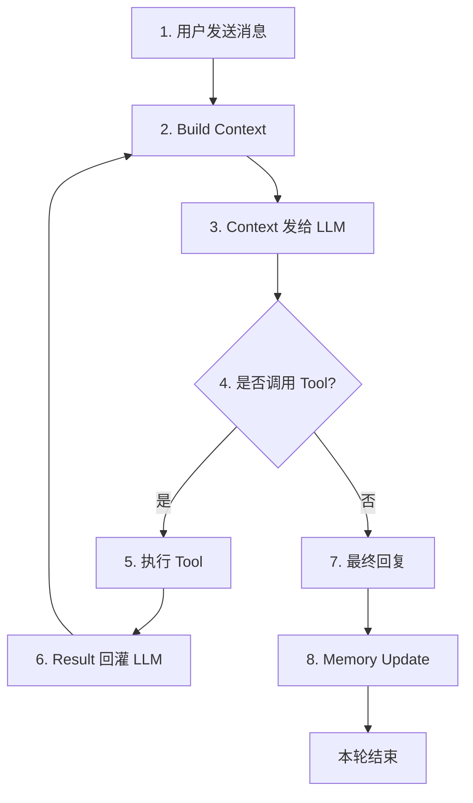

# hermes-agent 核心 loop 部分总结

## 先看流程概况



这个没啥好说的，ReAct 思路下的传统 loop 了
接下来我们逐步拆分下实现细节

## 1. 整体的 while 循环，如何工作，如何刹车

### 功能

整体的 while loop 只负责三件事：**把状态（messages）递给模型、把模型的意图（tool_calls）变成执行、把执行结果写回状态**。

### 刹车

外部的刹车限制主体有三：最大轮次 max_iterations、预算余量 iteration_budget、预算耗尽保底 grace

前两者好理解，最后一个的存在主要体现在：
某次 tool 结果产生但预算耗尽了，于是不许再 loop 下去刷成本了，要求模型回一个最终文本回复终止该 turn

还有一种刹车体现在循环逻辑：没有调用 tool 就结束

### 漏洞与优化
- **“没有 tool 就结束” 存在不需要调用 tool 但未结束的隐式问题（虽然情况比较少）；或者说是把控制流完全外包给模型** —— 考虑引入显示的终止动作 finish 显式验收

## 2. 发出的内容 wire 的拼装

**llm 没有记忆，所以最终的消息需要每次拼接上下文然后发过去**

消息整体包括这几部分：
- system prompt —— 在会话开启时就冻好了的快照，具体去看 memory 篇章
- messages —— 会话历史，load_conversation_history() + append(），一个只加的 list ，由 user、assitant、tool 三部分组成

system prompt 本章不提

关于 messages，有必要提的是，它其实 load_conversation_history() 过程中专门筛掉了其中的 system 部分，只留下了 user、assitant、tool。
```python
return [m for m in messages if m["role"] != "system"]
```
因为 load_conversation_history() 中的 system 真的是完全不动的部分了，它就是第一次消息中的 system 部分。

但 system 并不是真的完全不要了，往下看

wire 作为最终 HTTP 发出去的消息，是由 messages 再处理了一小下后，与 system 拼装后的内容（一般 system 默认第零条），我们举个差别例子：

messages:
```python
{
    "role": "assistant",
    "content": "",
    "tool_calls": [
        {"id": "call_00_66x…", "type": "function",
         "function": {"name": "todo", "arguments": "{\"todos\":[…],\"merge\":false}"}}
    ],
}
```

wire:
```python
{
    "role": "assistant",
    "content": m.get("content") or "",     # None 变 ""
    "tool_calls": m["tool_calls"],          # 原样搬，但只搬这一个键
}
```

这样可以把  messages中藏着的 _meta、_trace_id、_retry_of 过滤掉，统统不会出现在  wire 里

然后为什么又要拼 system 进去，为什么多搞一步，这有什么区别？

是因为 system 在每次会话启动时是会组装一次的，也就是会随 MEMORY.md 的更新而变动，所以选择单独组装一次这份会变的 system，而不是 messages 中那份就像撤不回改不了的历史消息一样。

最终一次请求 = 四样东西
```
① system
② 之前的对话
③ 本次新增（只有这里会随对话加长）
④ tools schema
```

### 漏洞与优化
- **`content` 标空用 `None`** —— tool_calls 时 content 通常是空，但字段必须存在，因此`content` 用 `""`
- **全量重发是 O(n²) 的 token 消耗** —— 显式缓存断点（cache breakpoints）+ 只增量发送
- **工具返回值没有任何治理** —— 小结果直传、大结果截断 + 摘要 + 存外部句柄，模型需要时再 `read_handle`

## 3. LLM 适配层：chat_with_tools

### 功能定位

消息出门的地方，把上一节内容打包成请求

通过 make_chat_with_tools 与 chat_with_tools 共同实现

简单看看：
```python
def make_chat_with_tools(api_key=None):            # 只跑一次
    client = OpenAI(api_key=key, 	base_url="https://api.deepseek.com")

    def chat_with_tools(*, system, messages, tools=None, ...):   # 每圈一次
        wire = [...]                                # 洗
        resp = client.chat.completions.create(...)   # 发
        return _to_assistant_namespace(resp.choices[0].message)  # 降级

    return chat_with_tools                          # 返回函数本身，不加括号
```
make_chat_with_tools 创建连接与打包，成本高的每次只跑一次
三个好处：` client` 只建一次（连接池复用）；key 只在启动时读一次（循环里不出现密钥）；可替换 —— 测试时塞假函数就能离线跑完整个 while，一次 API 不打

chat_with_tools 没券一次，负责具体工作

## 4. 工具分发：`registry` 与 `invoke_tool`

### 功能定位

把模型吐出来的 tool name 联系到具体的 tool 上去。registry 作为注册表，负责「名字 → handler」的映射；invoke 作为 agent 级的工具，负责真正工作，分发 registry 、截胡

一个比喻：**registry 是公司花名册（全公司共用，但不认识任何人）；invoke_tool 是前台（接单、判断归谁、补齐信息）

### 关于实现

**(a) registry 剥开就是一个 dict**

```python
self._tools: Dict[str, ToolEntry] = {}     # registry.py:57
```

`ToolEntry` 里真正有用的只有两对：`schema`（告诉模型长什么样）+ `handler`（真正打电话）。它一生只回答两个问题：

| 问题 | 方法 | 谁在问 |
|---|---|---|
| 世界上有哪些工具、长什么样？ | `get_definitions()` | 拼请求之前 |
| `web_search` 归谁负责？ | `dispatch()` | 模型说要调它时 |

get_definitions() 组装发给模型的 OpenAI tools schema 列表
dispatch() 执行已注册 handler，返回 JSON 字符串

**(b) `invoke_tool` 有三个 registry 没有的权力**

invoke 

```python
def invoke_tool(agent, function_name, function_args, ...):   # 第一个参数就是 agent
```

1. **能伸手进 agent 级别，附带状态**：`store=agent._todo_store`
2. **能越级办事（截胡）**：`if function_name == "todo"` 直接调函数，不走注册表
3. **能补齐工具自己不知道的信息**：`task_id`、`tool_call_id`

**(c) 为什么必须分开：寿命不同**

| | registry | invoke_tool |
|---|---|---|
| 出生 | import 时（进程启动） | 每次调用时 |
| 活多久 | 整个进程 | 几毫秒到几秒 |
| 有几份 | **全局一份** | 每调一次一份 |
| 带状态 | 不带 | 带着整个 agent |

### 漏洞与优化

- **todo 必须被截胡** —— **它要的是一个实例（`TodoStore`），而注册表只认参数。** 把需要实例状态的东西塞进全局注册表，等于让单例持有会话数据——两个用户同时用就串数据，会话结束还留引用就内存泄漏。
- **「截胡」破坏了分层一致性：同一个 tool_calls 数组有两条执行路径** —— 把「agent 私有依赖」抽象成注入上下文（ToolContext），让所有工具走同一条 dispatch 路径，由注册表统一注入
- ** 工具发现靠手工 import** —— 约定式发现（扫描顶层 `registry.register(...)` 自动导入）

关于第二、三条有优劣势比较：
- ToolContext 与 手工 import 的方法适合小项目，优势如上
- kwargs 与 运行时发现 扩展性强，能更兼容第三方作者，适合 hermes 这种大项目

## 5. 工具执行与回填：`_execute_tool_calls_sequential`

这部分负责执行工具结果回填，但这部分是一个有一定的副作用的部分，我们往下看：

### 实现核心

**(a) 它没有返回值**

```python
def _execute_tool_calls_sequential(...) -> None:
```

它的工作核心在于直接改 `messages` ，把结果放入里面。
**为什么不 `return results` 让上层批量 append？因为配对关系容不得错位** —— 中间某条失败被跳过，返回列表长度就和 `tool_calls` 对不上，后面的 id 全串位。**「调一条、立刻写一条」让每次写入都是当下可验证的。**

**(b) 五步**

```
① 取一条 tool_call（模型给的是字符串）
② 解析参数（json.loads，失败兜底）
③ 分流执行（todo 截胡 / registry.dispatch）
④ 立刻写回一条 role=tool（tool_call_id 原样照抄）
```

**(c) 一条铁律：1 进 1 出，顺序不动**

```python
messages.append({
    "role": "tool",
    "tool_call_id": tc.id,     # 原样照抄，绝不是重新生成 uuid
    "name": name,
    "content": result,
})
```

**N 个 `tool_calls` → 恰好 N 条 `tool` 消息，id 一一对应，顺序一致。** 少一条、多一条、串一个号，下一次请求直接 400。

**(d) 串行是有意的**

函数名里的 `sequential` 是明写的。三个理由：**顺序要确定**（`todo` 的 merge 依赖先后）、**错误要能归因**、**部分失败要能表达**。先正确，再快。

### 漏洞与优化

- **纯串行，无并发，浪费时间** —— 按元数据的 `parallel_safe` 分组：只读工具并发、有副作用工具串行
- **写回是逐条的，而 assistant 是一次性写好的**
eg：第 2 条抛异常 → assistant 已经声明了 3 个调用，但只回了 1 条 tool → messages 永久失配
—— 执行阶段整体包 `except`，给未应答的 `tool_call_id` 补 error 结果（保证序列合法）；或先收集后统一写入，用「占位 error 再覆盖」保证长度始终一致

## 6. 预算、grace 与中断

这部分与 agent 的控制、保护有关，后面应该会写一份那部分的专栏。

这里我们稍稍讲下 grace

### grace 的本质

模型刚拿到工具结果、还没来得及说话，额度就没了，如果直接掐掉用户只能拿到一堆半成品
所以**再给一次机会，但这次不许调工具，只许说话**。
这也是为什么能看到类似「`API call #7` 但 `budget used=6`」，grace 这一次是被控制了不许在烧额度的

触发条件三个，缺一不可：`final_response is None` + 未被中断 + **最后一条消息是 `role=tool`**。第三条是精髓：意思是「模型还没看到这个结果」。

### 漏洞与优化
- **grace 的实现与语义打架**，为了「只许说话」去改 system、摘 tools，容易导致意图的漏洞 —— 不改 system：在 messages 尾部注入一条 user 消息（「请直接给结论」）；或引入 `finish` 工具作为唯一合法终止动作

## 7. 计划层：`todo`

### 功能定位

现在许多 Agent 场景下依旧喜欢使用 todo 来作为模型的工作记忆外挂，这种实现体量小，更便捷
但当然了，我们还有其他的记忆外挂方式

todo 提供的并不是控制流（循环是不知道 todo 存在的），而是**决策依据**：让模型每圈都能看到一张干净的任务清单。

### 实现亮点

**(a) 永远返回全量**

```
TODO_SCHEMA description: "Always returns the full current list."
```

因为**模型只能通过返回值知道当前状态**。只回 `{"ok": true}` 的话，模型下一圈就不知道计划长什么样了。

> 这和「messages 全量重发」是同一条原则的两个化身：**models 没有记忆，也没有状态。凡是模型需要知道的东西，都必须出现在「这一次」的输入里。**

**(b) 设定`merge` 值来决定工作方式**

| `merge` | 行为 | 场景 |
|---|---|---|
| `false`（默认） | 整表替换 | 刚开局，立全新计划 |
| `true` | 按 id 打补丁 + 新增追加 | 做到一半，「第 2 条完成了」 |

`merge=true` 让「只报变化」成为可能，**不容易因为漏写一条而让任务静默消失**。打补丁比重发全表便宜。

**(c) `summary` 是给模型扫一眼的进度条**

```json
{"total": 3, "pending": 2, "in_progress": 1, "completed": 0}
```

**返回结构要照顾「扫一眼就能决策」，而不是「信息最完整」。** 让模型去数数组既费 token 又容易数错。

### 漏洞与优化
- **「完成」没有验收动作**：计划做完与否只靠模型自述 —— 加入类`finish` 工具让结束成为一个要校验的动作，工具内部检查「还有没有 pending」；加 verify-on-stop 钩子做证据检查
- **纯输出任务会被写进 todo**
这部分联系到上文第一节中 loop 的结束判定漏洞：这类任务不产生 tool_call，一旦排在中间，「不调工具」被当成「全部结束」，后面的任务永远做不到
—— 明确约束「todo 只记需要调工具的动作」；或从协议层区分「本轮结束」与「任务结束」

## 8. 工具返回形状设计

返回形状决定**模型「有没有资格认为自己已经知道答案」**。同一套循环，工具返回的形状不规整，模型就会瞎猜。

我们这里以常见的 web_search 为例

### 实现核心

**(a) 三个后端的原始形状完全不同**

| 后端 | 原始形状 |
|---|---|
| Tavily | `{"results": [{title, url, content}]}` |
| ddgs | `[{title, href, body}]`（**裸数组，没有外层对象**） |
| DDG Instant | `{AbstractText, Heading, RelatedTopics: [...]}`（**连字段名都不一样**） |

原样丢给模型，它每次都要重新猜「这次结果藏在哪个键里」。

**(b) 统一成固定形状**

```json
{
  "success": true,
  "data": {"web": [
    {"title": "...", "url": "...", "description": "...", "position": 1}
  ]},
  "_metadata": {"backend": "ddgs"}
}
```

| 字段 | 给谁 | 干什么 |
|---|---|---|
| `success` | 模型 | **一个开关**：先看成功没成功，再决定读数据还是处理失败 |
| `data.web[]` | 模型 | 结果本体，固定三件套 |
| `position` | 模型 | 让它在回答里能说「第 3 条」，过滤后不错位 |
| `_metadata.backend` | **人** | 排查用 |

**(c) 形状固定是幻觉防线，不是洁癖**

模型不是每次现场解析 JSON 的，它是靠「见过的形状」直接读的。形状随 backend 浮动，这个「学会的读法」就失效，它只能猜——**而模型猜不到的时候，很少说「我没看到结果」，它更倾向于编一个。**

### 漏洞与优化
- **`position` 用 `len(web)+1` 而不是 `i+1`**。
因为空结果会被 `continue` 掉。用原始下标会出现 `1,2,4,5` 的空洞，模型会困惑「第 3 条去哪了」。编号必须永远连续。

- 其他的漏洞与优化的设计思路与 agent 控制、兜底、保护差不多，稍微举几个小例子就懂了：
	- 在「出故障」时降级做循环式降级
	- 返回里带轻量质量提示或检测
	- 在工具 schema 或 ToolEntry 做「成本/延迟」声明
	- 返回体长度进行治理；或发模型用紧凑  JSON

## 问题速查

稍微粘些 AI 给出的面试问题，有兴趣看就看吧

**Q1：描述一下 ReAct agent 的主循环。**
> 一个 while + 一张只增不改的 messages。每圈把 system + 全部 messages + 工具 schema 全量发给模型；模型若返回 `tool_calls` 就执行、把结果以 `role=tool` 写回、继续下一圈；若返回纯文本则收尾。循环本身不含智能，只做状态搬运。

**Q2：模型没有记忆，agent 是怎么「记得」的？**
> 靠每圈全量重发 messages。所以工具返回值必须完整、带 `tool_call_id`；assistant 带 `tool_calls` 的那条也必须原样写回——否则模型看到「一堆结果但没有对应的调用」，逻辑就断了。

**Q3：工具调用结果怎么和调用对上？**
> `tool_call_id` 一一对应，N 个 tool_calls 对应 N 条 tool 消息，顺序一致。少一条或串号，下一次请求直接 400。所以执行是「调一条、立刻写一条」，不是先收集再批量写。

**Q4：agent 怎么知道任务做完了？**
> 它不知道。循环只认「这一圈有没有 `tool_calls`」。所以 `completed=True` 的准确含义是「模型声称没有更多要做的了」——不是「任务完成了」。这也是设计上最大的语义冲突：纯输出任务会被误判成结束。

**Q5：怎么防止无限循环 / 失控？**
> 三个刹车：圈数上限、预算计数（原子 consume）、grace 逃生门。再加中断标记（圈首检查）。生产版还有分类重试、压缩、工具护栏、超时与 fallback。

**Q6：工具报错会不会把 agent 弄崩？**
> 不应该。`dispatch` 统一 `try/except`，把异常转成模型能读的 error 文本——模型看到 `{"error": "timeout"}` 下一圈会自己换办法。**这才是 ReAct 能自愈的机制来源。** 如果异常抛到循环外，agent 就失去了「知道自己失败」的能力。

**Q7：为什么工具要经过 registry 而不是直接 if-else？**
> 三个理由：工具是分散注册的（主程序 import 不到）；加工具不该改主循环；错误处理只写一次。本质是「名字 → 实现的映射」是模型世界与代码世界之间唯一的桥。

**Q8：为什么有的工具要「截胡」？**
> 因为它需要 agent 的私有状态（如 `todo` 需要 `TodoStore` 实例）。注册表是全局无状态的，塞进去就等于让单例持有会话数据 → 多用户串数据、内存泄漏。分界线划在「全局能力」与「会话状态」之间。

**Q9：上下文太长怎么办？**
> 阈值触发压缩（调用前预压 + 响应后复压），压缩后**单独回注任务清单**。细节：只算 `prompt_tokens` 不算 completion（思考模型会提前触发）；压缩失败要有冷却期防抖。

**Q10：怎么调试一个「答案不对」的 agent？**
> 按圈对齐三栏：请求尾巴 / 模型响应 / 工具结果。重点看三件事：`arguments` 原文 vs `args` 解析后（抓静默兜底）、`tool_calls` 与 `tool` 条数（抓配对断裂）、搜索 query 的演化（判断是不是在空转）。**trace 只能证明，不能推测。**

**Q11：你从这个项目里学到最重要的一课？**
> **失败往往不在循环代码里，而在「工具集的形状」和「提示词的措辞」上。** 实跑那次搜索空转了 4 次，根因是没有 `fetch` 工具——模型知道答案在哪但读不到，只能反复换词榨摘要。所以 agent 效果不好时，先看它手里的工具够不够用，再怪模型。

**Q12：如果让你重做一次，你会改什么？**
> 三件事：① 用 `finish` 工具把「结束」变成可校验的动作，消灭 `tool_calls` 空值的双语义；② 预算改按 token 计量，housekeeping 工具免单；③ trace 记真正发出去的 wire + usage + 耗时，让它成为证据而不是影子。


## 尾声

这篇文章主要是讲讲 hermes agent 的核心 loop 部分的工作逻辑以及实现核心

至于源码的设计不可能如此得短，肯定有大量的检测、兜底、判断等护栏，但本篇不讲护栏内容

Thanks for Reading
